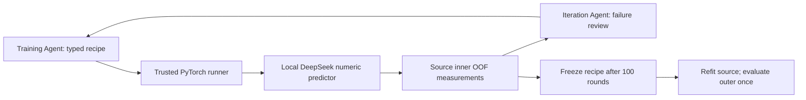

# Round19: two scientists, a local predictor, 100 candidate experiments

Round19 moves the main experiment from selecting a named expert to training a
continuous expression-response predictor. Two separate DeepSeek-V4-Pro API
histories propose training recipes and review **source-only** measurements.
The local predictor uses the official pretrained
[DeepSeek-R1-Distill-Qwen-1.5B](https://huggingface.co/deepseek-ai/DeepSeek-R1-Distill-Qwen-1.5B)
snapshot. These distilled Qwen weights are distinct from the API model, as
documented in [DeepSeek's release](https://github.com/deepseek-ai/DeepSeek-R1).

The code trains numerical input maps and a response head, with optional LoRA
updates inside the transformer. It does not fine-tune the API scientists. It
does not generate or grade natural-language chains of thought. Learned attention
over numerical and gene/condition tokens is not evidence of causal biological
reasoning.

The public language backbone's pretraining data overlap has not been independently
audited. Legal source supervision does not establish absence of public pretraining
overlap. This qualification is retained in `summary.json`.

## What the uploaded Round18 package established

The `round18_review_light (1).tar.gz` package has 1,011 checked payload hashes and
a completed run. It contains the **2 × 2 BXPC3 seed17 pilot**, not the later 6 × 3
experiment. The four source-search arms retained the baseline:

| Source search | Best valid candidate MSE | Source zero MSE |
| --- | ---: | ---: |
| Fixed | 0.006220803 | 0.006121251 |
| Random | 0.006171532 | 0.006121251 |
| Agent, plain | 0.006253099 | 0.006121251 |
| Agent, literature | 0.006273702 | 0.006121251 |

Each API research arm made three requests: a valid experiment, a rejected
proposal and/or an explicit stop. The literature rejection was a bounded
LayerNorm dimension check. The original plain rejection's discarded response
cannot be reconstructed. No candidate was promoted.

On the 3-target BXPC3 live-routing subset, one-shot and adaptive DeepSeek,
the fixed source choice and conservative routing all had the same MSE as zero:
**0.001728410**. Legacy fixed without zero was 0.001800942; original risk/workflow
were 0.001732290. This verifies conservative model calls, not an accuracy gain.
The light package lacks the raw prediction/response arrays needed to independently
reproduce gene-level MSE. This remains an observed development background.

## Architecture and scope



Available inputs are the source-trained B2 background representation, public
STRING target features, gene/condition tokens and aligned numerical teacher
predictions. B2 is the earlier expression projector, **not** pretrained Qwen
language-model inference. The new local DeepSeek branch really executes a
pretrained language transformer.

Three existing numerical families are connected: STRING Ridge and factor16/32.
Their original fold-specific P4 weights predict source calibration/held queries.
For student training rows, numerical response heads are refitted with the entire
predicted training cell line excluded. Cross-fitted factor-style heads use fixed
training steps; Ridge uses a fixed alpha. Shared B2 covariate transforms belong to
the student's source fold; nested teacher PCA, response bases and response heads
exclude the predicted training line. This is **response-head cross-fitting**, not
a claim that the whole unsupervised background pipeline is independently
cross-fitted at every level. Check `caches/*/lineage.json` for the exact rows.

Public State ST, TxPert, CellOracle and old globally trained Qwen adapters are
**not imported as leakage-free teachers**. Their fit histories/preprocessing need
new fold-specific adapters. `external_native_teachers` explicitly records
`NOT_CONNECTED`; no substitute or fabricated prediction is used. A matched
Qwen-backbone control retrains on the current legal source folds when its local
verified snapshot is supplied. It does not reuse an old student that saw a held
cell line.

## The predictor

Continuous background, target and each teacher's response coefficients map to
transformer-sized numerical tokens. Short gene/condition text tokens and a final
prediction token follow them. The final hidden state predicts rank16/32 signed
coefficients; the response basis is fitted exclusively on source-fit responses.
The frozen gene panel and response units remain unchanged.

The training scientist can vary:

- Frozen transformer or LoRA on query/value projections; an explicit MLP control.
- Teacher subset and STRING input on/off.
- Direct output, teacher-mean residual correction or learned teacher gate plus correction.
- Rank16/32, width32/64/128 and bounded learning rate/weight decay.
- MSE/Huber, optional teacher distillation and a training-only target specificity loss.

It cannot modify Python, dataset splits, normalization, gene order, teacher
provenance, optimizer-step budgets or the evaluator. Source specificity compares
other targets only within matching measured conditions. Norm ratios and cosine
are reported so shrinking toward zero cannot be called biological specificity.

## Precisely what 100 means

The default is **100 candidate rounds for one BXPC3 development fold and seed17**.
Every accepted, novel candidate receives three inner background fits, each with
500 optimizer steps. The best local DeepSeek candidate is selected by macro
source MSE. A separate source deployment choice includes zero and fixed controls,
so a weaker searched candidate is not automatically endorsed for deployment.

Upper limits for the default dual run:

- 100 training-agent requests plus 100 independent review-agent requests.
- 300 candidate inner fits and 150,000 candidate optimizer updates.
- Four fixed predictor controls × three inner fits, plus optional matched Qwen.
- Fixed final controls and at most one searched DeepSeek final refit, after freeze.
- One-off nested teacher response-head cross-fitting; downloads are separate.

Every invalid or repeated proposal consumes its round/request slot and feeds back
to the next round. Such a round does **not** count as a successfully trained
candidate. There is no automatic early stop before 100 attempted rounds and no
unbounded corrective retry. Authentication, transport and worker failures pause
with a durable audit/checkpoint; resume the identical command. API requests with
unknown outcomes remain counted. Actual tokens, attempts and worker time are
reported; currency cost is not estimated.

An HTTP-200 response with `finish_reason=length` has reached the output-token cap
before producing a valid final decision. Output tokens include reasoning tokens:
all 8,192 can be used on reasoning before any JSON appears. Such a response now
consumes its original slot without being retried. A truncated training decision
rejects that candidate round; a truncated review marks feedback unavailable while
preserving the completed training result. No partial text is parsed/executed and
no review advice is invented. The following round still receives real source
measurements. `completed_reviews` and `missing_review_rounds` distinguish these
outcomes from successful reviews.

For an incomplete **95d0882** run paused on this exact token-limit error, repeat
the original command with `--resume --repair-truncated-responses`. The migration
checks unchanged prediction/cache/agent modules and unchanged folds, seeds,
training steps and API configuration/budgets. `recovery/` retains the original
plan and migration receipt. Completed fits and paid counters are not reset.
Migration is rejected after source selection/final evaluation has started.
Subsequent resumes only require `--resume`. Increasing output tokens or changing
reasoning effort is a separately configured new experiment, not a silent change
to this run.

Fixed controls include DeepSeek without teachers, fixed fusion, LoRA fusion and
an MLP with the same numerical inputs. The optional Qwen control uses the same
folds/features/loss/steps. Full single-agent/random **equal-round search** controls
require their own run names with `--search-mode single` or `--search-mode random`.
Fixed recipes alone cannot establish the second scientist's independent benefit.
Transformer/MLP compute and trainable parameter counts differ and are reported.
Untrained teacher-average projections in the student's rank16/32 response bases
are also reported, separating response-basis smoothing from a backbone gain.

## AutoDL commands

The default source is the completed `round18_pilot_01`. Its training files and
data paths must still exist. The default fold must be present in `inputs.json`.
Other backgrounds require a completed source run with their legal nested folds.
The existing Round18 files are read-only; new artifacts go under a separate name.

```bash
cd /root/autodl-tmp/virtual_cell
read -rsp 'DeepSeek API key: ' DEEPSEEK_API_KEY
export DEEPSEEK_API_KEY

screen -dmS vcell19 bash scripts/run_round19_autodl.sh \
  --name round19_dual_100_01 --iterations 100 \
  --source-run /root/autodl-tmp/vcell-work/runs/round18_pilot_01 \
  --parallel-jobs 3 \
  --qwen-model-dir /root/autodl-tmp/vcell-work/models/Qwen3-0.6B-Base
```

Model download defaults to `https://hf-mirror.com`, with official pinned SHA-256
checks in `configs/deepseek_predictor.lock.json`. The new snapshot is about 3.56 GB.
Training uses `local_files_only=True` and `trust_remote_code=False`. Partial
downloads are retained by the Hub downloader. Omit `--qwen-model-dir` only if the
optional Qwen snapshot is absent; the report will explicitly mark that control
unrun. CPU tiny random models are solely test fixtures, never production fallbacks.

Inspect the planned scopes/budget without network or training:

```bash
.venv/bin/python scripts/run_round19.py --name round19_dual_100_01 \
  --source-run /root/autodl-tmp/vcell-work/runs/round18_pilot_01 \
  --qwen-model-dir /root/autodl-tmp/vcell-work/models/Qwen3-0.6B-Base \
  --prepare-only
```

Use exactly the same settings as the eventual launch (including optional paths).
After preparation, add `--resume` to launch. After any interruption, repeat the
original command with `--resume`; changing the number of rounds requires a new
name. Training resumes from the last saved step, using deterministic per-step
sampling/RNG. Completed workers and completed API responses are verified/reused.
Workers receive a stripped environment without API credentials.

```bash
watch -n 20 '.venv/bin/python scripts/round19_status.py --name round19_dual_100_01'
tail -n 40 -f "$(ls -t /root/autodl-tmp/vcell-work/logs/round19_pipeline_*.log | head -n 1)"
```

Parallel jobs are independent background folds, not data parallelism across
multiple GPUs. If three jobs exceed memory, use a **new** run with fewer jobs;
budgets/configuration stay immutable within a resumed run.

## Artifacts and interpretation

`iteration_progress.json` shows attempted rounds, actual evaluated candidates,
both API ledgers and the best source experiment. `trials/trial_NNN` preserves the
proposal, source result and independent review. Per-worker logs/progress show
gradient steps. `source_labels.npz` contains only fit/cal labels; held labels never
enter training workers. Source scores can be seen by the agents; outer scores
are computed only after `search_frozen.json` and `final_decisions_sealed.json`.

`comparison.csv`, `outer_per_query.csv` and `report.html` compare frozen recipes,
zero, teacher mean and the numerical experts on the same outer queries.
`round19_review_light.tar.gz` excludes raw expression, controls, numerical arrays
and weights. Model adapters and checkpoints remain on the server.

BXPC3 is not an independent test. Repeatedly optimizing 100 source trials can
overfit the inner folds; HT29 remains sealed. Add new development backgrounds and
optimizer seeds only in separately scoped runs, then freeze before external
confirmation. A successful training loop is not proof that LLM semantics, teacher
fusion, two scientists or a new foundation model improves prediction.
