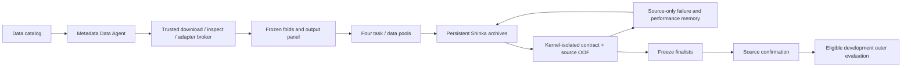

# Round23: persistent autonomous research campaigns

Round22 established real Shinka/DeepSeek code mutation but produced one valid new
repeat method, none for transfer, and no confirmed improvement. The received
recovery archive had 208 hash-verified payload files. Its 11 successful API calls
used 138,201 output tokens, including 122,609 reasoning tokens. Those engineering
and scientific outcomes are separate.

Round23 provides the next executable framework release. It has not been validated
as a biologically successful or generally mature autonomous scientist. Its main
acceptance criteria are reproducible identities, source-only feedback, actual
framework continuation, bounded failure recovery, and useful failure evidence.



## What can evolve

The full `fit_predict` body can change: background subtraction, features, source
selection/weighting, shared calibration, architecture, loss and optimization. A
candidate is not forced to use STRING, an LLM numerical backbone, or any specific
neural head. The cloud DeepSeek model generates algorithms; its weights do not
change. The framework itself, grader, data splits and promotion rules are trusted
code and are not editable by a generated worker.

Each pool keeps one real Shinka 0.0.7 database and archive. The orchestrator extends
its generation target in five-slot cycles, rather than restarting from scratch.
Three islands retain source-performance diversity. Between cycles the next prompt
receives only source-side scores, exception categories and failed code excerpts.
Shinka still handles mutation, parent selection and its archive; the controller
does not replace it with an independent LLM tree-search loop.

The four pools are `repeat_core`, `repeat_expanded`, `transfer_core`, and
`transfer_expanded`. They are scheduled round-robin, with one GPU evaluation at a
time. The default target is 25 distinct valid new prediction behaviors per pool,
100 total. Initial clones, duplicate code and bit-identical full prediction
artifacts do not count toward that target. A different behavior is not necessarily
a different biological mechanism or a significant improvement.

## Budgets and stop states

The frozen configuration is `configs/round23_campaign.json`:

| Budget | Default |
| --- | --- |
| New valid behavior target | 25 per pool, 100 total |
| Maximum cycles | 20 per pool |
| Slots added per cycle | 5 |
| Patch resamples / format attempts | 2 / 2 |
| Model | DeepSeek V4 Pro, low effort |
| Maximum output per call | 32,768, including reasoning |
| Research API calls / output tokens | 300 / 4,000,000 total |
| Data-agent calls / output tokens | Separately 4 / 131,072 total |
| Worker wall time | 12 hours cumulatively |
| Source search / random cutoff | 70% / 85% of worker budget |
| Remaining compute | Reserved for confirmation / final grading |
| Per worker | 120 seconds, 12 GiB monitored RSS, 500 optimizer steps |
| Source seed | 17 |

The 12-hour limit is accumulated worker time, not an end-to-end duration estimate;
network/API waiting and trusted preprocessing are additional. Actual currency
cost is not estimated. API usage is audited, including failed calls. Two
consecutive provider failures persistently open the relay circuit. Source pools
stop after three consecutive cycles without a new valid behavior (configurable). A target is not
a guarantee: `goal_reached=false` is explicitly reported if a campaign stops short.
`COMPLETE.json` means the bounded workflow/report completed, not that 100 methods
were produced or a scientific gain was obtained.

## Data access and expansion

`inventory` catalogs every `dataset.npz` under the work directory's prepared tree.
Inventory alone does not authorize every old validation/test artifact as training
data. The full launcher admits compatible, nonsynthetic prepared sources with
verified panel coverage and mean-log response normalization, plus audited external
source bundles. Dataset/row-ID duplicates retain the canonical Round21 artifact
first, independently of performance; admission and exclusion reasons are reported.
This detects matching unit identities, not all possible overlap between differently
named studies. Historical
non-test development rows can enter auxiliary source pools, after exclusions.

Each fold excludes the entire current query cell line and the outer cell line
from auxiliary sources, including other conditions of that line. Global held
targets, source-confirmation targets during search, and all current repeat-query
targets are also excluded where applicable. Reserved HT29/Jurkat and test-labeled
rows are never exported. External bundles require canonical cell-line identities
and HGNC target labels; unknown aliases are an adapter problem, not permission to
invent equivalence. New species require an explicit orthology task/adapter and are
not silently mixed with human gene perturbations. CRISPR modalities and stimuli
are supplied separately to the model, not relabeled as equivalent.

Expanded methods receive `aux_baseline`, `aux_delta`, `aux_target`, `aux_context`,
`aux_cell_line`, `aux_dataset`, `aux_stimulus`, `aux_modality`, `aux_batch`, and
`aux_time`. They can decide which authorized data to use. Core methods receive
empty auxiliary arrays. Both arms have identical query units and private truth.
Candidate workers receive arrays, not unrestricted filesystem/network access.

The initial approved public catalog contains three human genetic perturbation RNA
datasets, downloaded from the checksummed scPerturb v1.4 deposit:

* Papalexi THP1 ECCITE RNA, GSE153056: source expansion candidate. This study examines
  immune checkpoint regulation and IFN-gamma-related responses. Its input condition
  is kept `unknown` unless explicit metadata establishes it; the catalog does not
  label all cells as IFNG merely from a paper's title.
* Shifrut primary T cells, GSE119450: reserved external cohort. The current search
  and data agent do not use its perturbation outcomes. Final external evaluation
  is not implemented or claimed by this campaign command.
* Adamson K562 CRISPRi, GSE90546 (10X005): a separate source study, not another copy
  of the existing Replogle screen. Whole-K562 held-line exclusions still apply.

Sources: [scPerturb v1.4](https://zenodo.org/records/13350497),
[GSE153056](https://www.ncbi.nlm.nih.gov/geo/query/acc.cgi?acc=GSE153056),
[GSE119450](https://www.ncbi.nlm.nih.gov/geo/query/acc.cgi?acc=GSE119450).
The catalog can be extended with approved URLs or ready source bundles. This
release offers catalog-based acquisition and metadata adaptation, not unrestricted
web browsing or automatic ingestion of arbitrary studies.

## Data agent and common gene panel

The Data Agent gets publication metadata, observation/variable fields and small
metadata summaries. It can propose count layer, gene column, perturbation/control
labels and matched-control strata, with one revision after an adapter error. It
cannot set paths, gene aliases, cell-line identity, normalization, thresholds or
roles. Trusted code downloads, checks MD5, validates the schema, and normalizes raw
counts using `mean(log1p(10000 * counts / full RNA library))`. Logged values are
rejected rather than normalized twice. Unmeasured genes are never filled as zero.

If all 1,834 old output genes are not measured, this new round can freeze a
measured annotation-only intersection, at least 1,000 genes. Existing audited
Round15 Ensembl/HGNC annotations resolve names; the Data Agent cannot invent a
gene mapping. A bundled full HGNC identity snapshot contains 102,895 unambiguous
approved/previous-symbol or Ensembl joins from the already downloaded official
2026-10-05 table. The same identities drive source admission and held-target
exclusions, including Ensembl version suffixes; unresolvable auxiliary targets
are excluded. Informal aliases are not guessed. The snapshot's upstream SHA-256,
builder and provenance are retained. See [HGNC downloads](https://www.genenames.org/download/statistics-and-files/).
All four pools use the same common panel. Output labels and masks
are sliced before search; full-library normalization remains unchanged. Original
control/STRING projection features remain source-fit covariates. These scores
must not be presented as directly comparable to Round22 full-panel MSE.

`ready_catalog.json` records the exact genes and source hashes. Ambiguous or
insufficient sources remain BLOCKED with reports. The full launch script requires
at least one new READY source; it does not quietly run a supposed external-data
experiment using only historical data. The default public source download is
about 286 MB compressed for the two new source files; adapters may need more scratch space. Downloads reserve
20 GiB free disk plus a 2 GiB per-file cap and retain failed partial files.

## Run on AutoDL

Existing `.venv` and pinned data-disk Shinka environment are reused. No reinstall
is required if Round22 ran. Pull main, then launch the complete pipeline:

```bash
cd /root/autodl-tmp/virtual_cell &&
git -c http.version=HTTP/1.1 pull --ff-only &&
read -rsp 'DeepSeek API key: ' DEEPSEEK_API_KEY &&
echo &&
export DEEPSEEK_API_KEY &&
mkdir -p /root/autodl-tmp/vcell-work/logs &&
screen -L -Logfile /root/autodl-tmp/vcell-work/logs/round23_full_01.log \
  -dmS vcell23 bash scripts/run_round23_full_autodl.sh round23_evolve_01 round23_data_01
```

The script runs inventory, public-source acquisition/adaptation, checks that a new
source really is ready, then numeric smoke and the full campaign. Status and logs:

```bash
.venv/bin/python scripts/round23.py status --name round23_evolve_01
tail -n 50 -f /root/autodl-tmp/vcell-work/logs/round23_full_01.log
cat /root/autodl-tmp/vcell-work/data_agents/round23_data_01/summary.json
```

For a numeric framework check with existing data, without paid API:

```bash
bash scripts/run_round23_autodl.sh --name round23_framework_smoke_01 --mode smoke --resume
```

That check does not establish external data readiness. To continue a full
campaign after a process interruption, reuse its exact catalog/config/name:

```bash
bash scripts/run_round23_autodl.sh --name round23_evolve_01 \
  --catalog /root/autodl-tmp/vcell-work/data_agents/round23_data_01/all_catalog.json --resume
```

Completed candidate assessments are content-addressed and checksummed. Research
journal entries form a verified hash chain; an interrupted final append can be
recovered without rewriting prior committed events. Completed campaigns are
verified rather than reexecuted. After the source freeze, resume never reopens
Shinka/API search. Changed trusted code/config/data requires a new campaign name.
There is no automatic quota reset or silent budget increase.

## Grading, promotion and evidence

Before complete source OOF, generated code must pass the immutable entrypoint
contract under the same Landlock/seccomp worker used for real evaluation. It gets
two query rows and a five-step budget for two independent reproducibility checks
(rtol 1e-5, atol 1e-7), not hidden truth. Failure categories include syntax, shape, dtype/linear algebra, resources,
nonfinite output, and forbidden operations. Duplicate failures are cached; new
code is needed to repair an algorithmic failure. Source grader quality rules stay
fixed. Foreign held-line responses never enter source memory.

Full source OOF scores use the strongest source-selected fixed baseline, correct
vs wrong/shuffled target controls, amplitude and specificity diagnostics. Only
source-screen-passing evolved finalists proceed to source confirmation. Only
confirmation-screen-passing transfer candidates trigger development outer scores.
Other cases produce `OUTER_NOT_RUN.json`; this is a defined stop state, not an
exception. The fixed seed and random comparator can still be confirmed for context.
The current release uses seed 17, not a three-seed efficacy study.

Random comparison targets the same number of valid distinct candidates as Shinka,
with its own attempt/compute limits. Any mismatch is reported. Its disclosed
source-selection/rank/regularization/mixing grammar is narrower than arbitrary
LLM code, so this does not establish a fully search-space-matched advantage.

Keep full server SQLite databases, worker artifacts and inputs for reproduction.
The light review includes all candidate assessment errors, generated Python,
source journals, failed proposal `attempt_log` exports, source/confirmation scores,
API usage and configuration. Large matrices/weights are excluded. Acquisition,
inspection and adapter report snapshots are copied into `data_evidence`; keep the
full data-agent directory too for exact numerical reconstruction. The archive is:

`/root/autodl-tmp/vcell-work/runs/round23_evolve_01/round23_review_light.tar.gz`.

Local tests cover contracts, failure memory, data roles, shared panels, immutable
resume and source/outer separation. A separate real installed-framework check
(`scripts/check_round23_shinka.py`) proves that a failed toy generation remains
in the database and a subsequent invocation extends the same archive to a repaired
generation. This check uses a local mock, not a paid provider or biological data.
Actual live mutation yield, external adapter readiness and scientific improvement
must be measured on the server; unit tests do not establish them.
